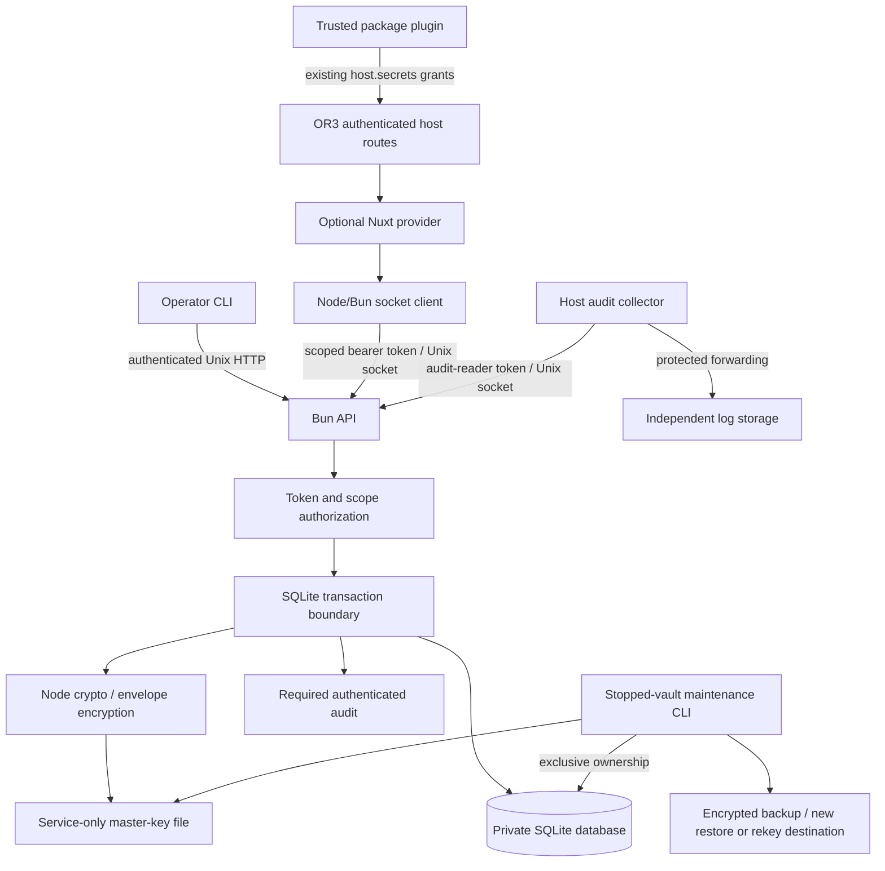

# Design

## Overview

Use one service process, one encrypted-value SQLite database, one Unix socket, and a small CLI. Bun is the proposed core runtime, subject to the assurance decision below. Keep application authorization in OR3 and storage authorization in the service. The master key never enters OR3. The optional provider uses a protected service-token file and a Node-compatible socket client.

This is a new implementation using standard cryptography, not a port or fork. Adopt explicit secret disclosure from secretctl and scope-bound envelope encryption/key separation from Dopbase. Their additional UI, execution, caching, and identity features are outside this product. [Source analysis](source-analysis.md) records the evidence and limitations.

Missing keys, invalid authority, required audit failures, and an unavailable configured provider fail closed. Availability is addressed through monitored capacity, explicit maintenance windows, and tested recovery targets. No automatic credential migration or offline cache is included.

### Assurance and production deployment

Record the intended deployment and whether it requires a FIPS-validated cryptographic module before qualifying the runtime. The initial Bun proposal makes no validation claim: a compatible `node:crypto` API, approved algorithm, or passing vector is not module validation. If validation is required, establish the exact acceptable module/build/platform/operating configuration and revise the runtime choice before implementation. Maintain one supported crypto stack. The [production security profile](security-profile.md) maps software controls, inherited infrastructure controls, evidence, and release gates; internal implementation results are recorded in [the receipt](../../docs/implementation-receipt.md); deployment and independent-review gates remain pending.

Production uses a dedicated service identity, private database/key mounts, and an explicitly shared socket. OR3 must not share the service UID or receive its database/master key. Named human administrators use the deployment's MFA-protected management path with attributable actions and controlled emergency access. The operator credential is root administrative authority because it can issue a credential that reads secrets. These are required deployment boundaries, not a new login, MFA, or monitoring subsystem inside the vault.

## Architecture



| Component             | Responsibility                                                                           | Requirements |
| --------------------- | ---------------------------------------------------------------------------------------- | ------------ |
| Lifecycle/files       | Explicit init, safe paths, exclusive ownership, durable completion, startup verification | R1, R8, R12  |
| Crypto                | Envelope encryption, authenticated state, domain-separated keys                          | R2           |
| Authority             | Token digest/policy verification, expiry, capabilities, exact scope matching             | R3           |
| API                   | Unix transport, strict bounded protocol, sanitized failures                              | R4           |
| Store                 | Prepared SQL, revisions/tombstones, transactions                                         | R5           |
| Audit                 | Transactional events, MAC chain, receipts, bounded export and attribution                | R6, R12      |
| CLI/maintenance       | Explicit input/output, backup/restore/rekey                                              | R7, R8       |
| SDK/Nuxt/host adapter | Node-safe provider and first consumer with existing OR3 authority                        | R9, R10      |
| Qualification         | Failure-first checks, release evidence and independent review gates                      | R11, R12     |

**Trust boundaries.** Filesystem access and separate process identities protect the key and client tokens; API bearer credentials protect socket operations; authenticated scope enforces the credential's storage boundary; AEAD protects persisted values; OR3's session and activation authority protects browser requests. Each is necessary. Socket access alone is insufficient, and a valid service token does not prove an end user's identity. A namespace-wide OR3 token is deliberately powerful across that namespace; narrower restrictions should be used where practical. Application-asserted audit attribution never adds authority.

**Threats addressed.** Copied databases/backups; accidental secret output; a client trying another workspace/owner/plugin; malformed requests; stale references/concurrent writes; modified ciphertext or policy; unsafe startup paths; failed audit writes; interrupted maintenance. A database writer may destroy or replay previously valid storage. AEAD/MACs detect altered authenticated material but cannot provide availability or external freshness. Root, same-service-UID compromise, memory inspection, and authorized consumer exfiltration remain outside the boundary.

## Components and Interfaces

### Proposed repository layout

```text
src/
  cli.ts                    # parseArgs; no CLI framework
  server.ts                 # Bun.serve Unix listener
  protocol.ts               # small shared wire types and validation
  files.ts                  # private files and ownership lifecycle
  crypto.ts                 # node:crypto only
  store.ts                  # bun:sqlite, authorization + data + audit transactions
  maintenance.ts            # stopped-vault backup/restore/rekey
  client.ts                 # node:http socketPath; bounded secret/audit client; no bun:* imports
  module.ts                 # optional @nuxt/kit module
  runtime/plugin.ts         # Nitro registration adapter
tests/                      # process/API/CLI/provider E2E; crypto vectors only as justified
docs/                       # security model and operator runbook
planning/secure-secret-store/
```

Start with these direct modules; split only when the implementation proves a need. No backend framework, ORM, JWT library, global plugin engine, additional daemon, or extra database. `@nuxt/kit` is the provider module's optional peer/build dependency. Bun and TypeScript types are proposed development dependencies. Avoid unnecessary dependencies, but do not replace a justified, reviewed dependency with custom security code merely to reach zero packages. Include the runtime and its native libraries in release dependency/vulnerability evidence.

### Service contract

```ts
type Scope = Readonly<{
  namespace: string; // operator-configured deployment boundary
  ownerUserId: string; // OR3's internal user ID
  workspaceId: string;
  consumerId: string; // trusted plugin ID for the first integration
}>;
type SecretRef = Readonly<{ id: string; revision: number }>;
type SecretMeta = Readonly<{
  ref: SecretRef;
  name: string;
  state: 'available' | 'deleted';
  updatedAt: string;
}>;
interface SecretStore {
  inspect(input: { scope: Scope; name: string }): Promise<SecretMeta | null>;
  list(input: {
    scope: Scope;
    after?: string;
    limit?: number;
  }): Promise<{ items: SecretMeta[]; next?: string }>;
  put(input: {
    scope: Scope;
    name: string;
    value: string;
    expectedRevision: number;
  }): Promise<SecretMeta>;
  resolve(input: {
    scope: Scope;
    selector: { name: string } | { ref: SecretRef };
  }): Promise<{ value: string; meta: SecretMeta }>;
  delete(input: { scope: Scope; name: string; expectedRevision: number }): Promise<SecretMeta>;
}
```

`expectedRevision: 0` means no record has ever existed. A tombstone keeps its ID and last revision; recreation must name that revision and advances it. A reference requires the exact current live revision. A name-based resolve atomically reads the latest live revision. Names never become filesystem paths. A reference from another scope is indistinguishable from a missing record.

Authenticated `POST /v1/secrets/{inspect,list,put,resolve,delete}` carries the complete request in JSON, keeping names and scope out of URLs. Each maps to one contract method. The method signatures above show operation data; wire bodies additionally contain the common `context` property defined below. Capability names are `metadata`, `read`, `write`, and `delete`, explicitly enumerated on a token. A `read` token does not implicitly get enumeration or mutation. The provider gets the capabilities its host adapter needs; tests use narrower tokens to verify separation.

`POST /v1/tokens/{issue,list,revoke}` accepts only the operator credential. Issuance returns a credential once over the protected socket to the CLI, which writes it directly to an exclusive private file. Credential kinds are disjoint:

- `service`: requires a namespace, optional exact restrictions on the other scope fields, and explicit capabilities from `metadata`, `read`, `write`, `delete`.
- `audit-reader`: explicitly vault-wide, with only the `audit` capability. Namespace filtering is unsupported and scope fields are rejected; it cannot access secret or token-administration routes. OR3's normal service token receives no audit capability.
- `operator`: may issue, list, and revoke both client kinds, but cannot directly use secret or audit-read routes. It can indirectly obtain those permissions by issuing a credential, so this is administrative route separation, not separation of duties.

Service and audit-reader credentials require explicit expiry; recommend 30 days and enforce a maximum of 90 days. Omitted or unlimited expiry is rejected. These are initial product policy limits, not standards-derived lifetimes; the deployment must choose a shorter lifetime where needed and test replacement before expiry. There are no globs, delegation, or arbitrary policy expressions. The operator credential is a nonexpiring recovery/bootstrap credential in separately protected custody, not a shared human identity. Routine use follows the named-administrator/MFA/attribution controls in the production profile. Lost or compromised operator authority is replaced offline using the verified fresh-key recovery/rekey workflow; do not keep the old authority active after cutover.

All requests require bearer authentication and a required `X-OR3-Vault-Id` header. Validate the expected vault ID before dispatching secret, token, or audit operations; return a sanitized mismatch without performing the operation. Keep response identity checks as well. This prevents a misconfigured valid socket/token pair from operating on the wrong vault; it does not authenticate a malicious socket peer or prevent that peer from receiving request bytes. Filesystem ownership remains the local server trust boundary.

Every endpoint JSON body includes a required top-level `context: { requestId: string; actorId?: string; activationId?: string }` alongside its operation-specific fields. The transport client generates an opaque request ID unless its caller supplies one for correlation, and accepts context explicitly per call. Reject unknown context fields. Each field is a nonempty string of at most 128 UTF-8 bytes without control characters or invalid Unicode. Do not include display names, email addresses, raw activation tokens, grants, or free text. The service records context as application-asserted evidence and never uses it to expand token or scope authority.

There is no unauthenticated diagnostic endpoint exposing vault identity. Token-authenticated `POST /v1/status`, whose body contains only the common context, may return protocol/schema version, expected-vault match, credential expiry, and bounded capacity/maintenance state, never secrets. No cookies, CORS, redirects, browser `Origin`, or HTTP proxy support. The client does not follow redirects and cannot switch to TCP.

Initial fixed limits: 256 KiB encoded request, 32 KiB decoded UTF-8 value, 128 UTF-8 bytes per nonempty name/scope field, 100 metadata results per page, 16 in-flight requests, 5 seconds to receive the body, and 1 second SQLite busy wait. Reject control characters and invalid Unicode rather than normalizing identifiers into aliases. Plugin IDs also retain OR3's existing validation. Cursor scope is reauthorized on every page; a cursor conveys no authority. Audit export additionally caps each page at 100 events and 256 KiB encoded response, with one in-flight audit read per credential and at most five admitted audit reads per second per credential. Pre-admission overload is bounded telemetry, not an unlimited stream of audit writes. Measure limits and backlog-drain capacity in qualification before changing them.

### Audit export contract

`POST /v1/audit/read` accepts only an audit-reader credential. In addition to the common context, its input is an integer `limit` in `1..100`, `after: { seq, mac } | null`, and an optional `through: { seq, mac }`. `null` is an explicit start from the beginning of history. Every complete vault contains an authenticated genesis event at sequence 1, so its through-head is never absent. Cursors carry no authority and refer to the original complete vault-wide chain, never a filtered reconstruction.

Within one synchronous transaction, authenticate the reader, validate the expected vault and cursor membership, and capture the committed through-head before adding the current access event. Reject `after.seq > through.seq`; an explicit beginning cursor precedes all events. Return ordered original events after `after`, at or before that fixed through-head, plus the last returned cursor and the same through-head. On an empty page the returned cursor remains the supplied `after`; do not advance it past retained events. Append a required `audit_read` event containing the known reader ID and bounded requested/returned positions, then commit before releasing the page. No audit records are released if that event cannot commit. Continuations supply the same through-head; reauthorize and validate both cursors on every page. A regressed, divergent, or rekeyed chain produces `409 audit_checkpoint_mismatch`, never an automatic reset of the collector's saved position.

The client stops after reaching the frozen through-head and waits at least 30 seconds before starting another polling batch. It never chases the access event generated by its own request. Each successful page is still audited, so bounded recurring access events are expected even while otherwise idle. Do not return an updated global head that could be mistaken for the current batch target. The collector advances its durable checkpoint only after independently retaining the corresponding events; duplicates after a lost acknowledgement are identified by vault ID, sequence, and MAC. A new key/history requires explicit operator reconciliation of linked old/new receipts.

An existing external collector owns protected forwarding, retention, alerting, and durable checkpoint custody. Monitor export lag, gaps, invalid checkpoints, capacity, service failures, and clock changes. The vault does not gain a second queue, log database, exporter plugin framework, or alert engine. Independently retained observations establish only the history actually observed; local commits not yet forwarded remain within the documented rollback boundary.

### Cryptography and filesystem lifecycle

- `init` generates a 32-byte binary master key and independent random vault/record/token IDs with `node:crypto.randomBytes`. No `Math.random`, password hashing, or external entropy service.
- Derive keys using HKDF-SHA-256 with vault ID as salt and versioned purpose labels: `wrap`, `record-mac`, `audit`, `verify`, and `backup`. Purpose bytes and encodings are specified once with fixtures.
- Each secret write generates a new 32-byte data key. AES-256-GCM encrypts the UTF-8 value with a random 12-byte nonce and 16-byte tag. Another independently generated nonce wraps the data key with the wrapping key. Never reuse a data key on update.
- AAD is UTF-8 JSON of a fixed-position, versioned array: domain, format, purpose, vault ID, record ID, all four scope fields, name, revision. Use separate `value` and `wrapped-key` purposes. Do not concatenate unescaped delimiter-separated strings.
- Authenticate the complete stored row, including its state and encrypted fields, with `record-mac`; this also protects tombstones. Authenticate each complete token policy/digest/revocation record with a distinct record domain. Use constant-time comparison for fixed-size MACs and token digests. Verify before using policy or returning metadata.
- The authenticated vault header records schema, key verification data, and the committed wrapping-operation count. Refuse further writes at one million recorded wraps under the current wrapping key; include every live record wrapped while constructing a fresh destination, rather than resetting its count to zero afterward. This counter is a guard for the committed history, not proof of a global invocation total across aborted encryptions, malicious rollback, or same-key clones. Fresh random nonces remain mandatory. Writable restore always creates a fresh master key; do not run writable clones under the same master key. Include failure/rekey accounting in crypto review and retain the explicit external-freshness limitation.
- Verify a known, vault-bound encrypted marker before listening. Missing or wrong keys are fatal. Verify the exact allowed schema objects, columns, constraints, and indexes; reject unexpected triggers, views, virtual tables, attached databases, and loadable extensions. `trusted_schema=OFF` is defense in depth, not an assertion that executable schema is disabled. Schema version changes require explicit stopped-vault maintenance; no startup migration machinery in v1.
- Establish `umask 077` before creation; private directories are `0700`, private files `0600`. Use exclusive creation and `O_NOFOLLOW` where supported, then `fstat` owner/type/mode checks. Require private, service-owned leaf directories and reject unsafe writable ancestors; account explicitly for sticky temporary parents in disposable tests. SQLite lives only in the validated private directory, including journal files.
- Flush newly created key/credential/data files and their parent directories before reporting durable completion. Completion markers and renames must follow an explicit file-and-directory synchronization order; an atomic rename alone is not a power-loss guarantee. Qualify the supported filesystem/VFS behavior.
- Acquire SQLite exclusive ownership before opening the listener or maintenance. Never unlink a pre-existing socket implicitly. On normal shutdown remove only the socket inode created by this process; document how an operator verifies a stopped service before removing a crash-left socket.
- Owner-only socket access is suitable for single-identity development. Production uses distinct service and client identities with an explicit dedicated socket-sharing group, a service-owned `0750` run directory, and `0660` socket mode, or an equivalent tested container boundary. Clients can connect but cannot replace the socket or write its parent directory. OR3 receives neither database nor master-key mounts. Never make the whole vault group-readable to solve socket access.
- Do not auto-load project `.env` files in the service launcher. Qualify Bun's `--no-env-file` behavior on the pinned version. Environment configuration may contain paths, never raw key/token/secret material. Runtime flags and inherited preload/debug behavior are under the trusted operator's control.

Use established Node [crypto APIs](https://nodejs.org/api/crypto.html), particularly AEAD final-tag verification. Avoid cryptographic format options: one versioned algorithm set. Mutable buffers are cleared in `finally` where possible; this is hygiene, not a promise that plaintext never exists in memory.

### CLI and client

Commands: `init`, `serve`, `status`, `put`, `get`, `inspect`, `list`, `delete`, `token issue|list|revoke`, `audit read|verify`, `backup`, `restore`, and `rekey`. Online `audit read` uses the bounded API; offline `audit verify` acquires stopped-vault ownership. Token issuance chooses an explicit service or audit-reader kind. Security maintenance is required for a usable store, not a new general administration platform. No shell execution or plaintext bulk export commands.

CLI options carry paths, scope, names, and revisions. `put` reads exact non-TTY stdin bytes, including a trailing newline if present, and refuses interactive terminal input. Document protected-file redirection and a newline-free input workflow without embedding a secret literal in a shell command. `get` refuses default output and requires `--stdout` or `--out-file` with exclusive `0600` creation. Credentials never go in flags or normal stdout. Mutations print metadata only. File-output failures return nonzero and do not fall back to stdout. A lost mutation response is not retried automatically.

The exported `/client` uses [node:http `socketPath`](https://nodejs.org/api/http.html), capped response size, an overall timeout, `AbortSignal`, no redirect handling, no response cache, and sanitized errors. It loads/validates the token file on each call so atomically replacing a protected file rotates credentials without a process restart. It sends the configured vault ID on every request and verifies it on authenticated responses. A deliberately wrong but internally valid socket/token pair must fail before a mutation; the separate socket trust boundary still applies. No secret or credential is embedded in a client factory's string representation or diagnostic output.

### OR3 integration

The new repository exports the CLI, `/client`, and optional `/nuxt`. OR3 receives a distinct `SecretStore` registry using `server/utils/registry/create-runtime-config-registry.ts`. Private runtime configuration is `secrets.provider: 'or3-secrets'` plus `secrets.socketPath`, `tokenFile`, `namespace`, and `vaultId`. The module only registers a Nitro provider; it does not own auth, sync, or workspace selection. Static builds do not start the service or embed credentials. Selection of an unregistered/unavailable provider fails closed; absence of a selected provider preserves current deployments.

First consumer: **remembered `host.secrets` for authenticated, package-backed trusted-host activations**. Add host-owned endpoints/adapter using the existing session and sealed activation mechanism in `server/utils/plugins/isolation/activation-authorization.ts`; reuse package selection, `authorizeHostActivation`, current grant review, and mutation intent/body limits. General `requirePluginAccess` alone is insufficient because it is not a `secrets.*` grant check. Never trust browser-provided grants, user ID, workspace ID, or package digest as authority.

OR3 supplies the common per-call context using actor/activation IDs derived from its authenticated session and sealed activation state, not browser assertions. OR3 authorization logs and the vault audit share the request ID; the scope owner is not assumed to be the acting human. The service authenticates the resulting audit event while retaining the explicit application-asserted attribution boundary.

The adapter captures activation/account/workspace generation, checks authority before dispatch, and checks liveness before publishing results. Keep requests bound to their original scope throughout. Authorization admits an operation at dispatch; an operation already sent to the separate service can finish after local teardown. Do not imply that aborting HTTP rolls back a committed mutation. Existing package lifecycle leases should be reused where required to prevent package promotion/disable races; do not introduce a second activation system.

Extend the internal browser `SecretStore` seam to allow awaited operations and catch provider errors in `trusted-mediation.ts`. The public `PluginSecretsClient` is already asynchronous. Preserve `secrets.read` for plaintext get/status, `secrets.write` for set/delete, and `secrets.use` for refs. The default omitted persistence option continues remembered behavior for compatibility; explicit `session` lives only in activation memory and shadows a remembered value for that activation. A delete first deletes remembered state successfully, then clears the session shadow; failure leaves a visible error. `ref` never resolves plaintext. The server service has no unlock/password state; `unlock` checks availability and returns a structured failure when unavailable.

The public setter lacks an expected revision: its adapter inspects then makes one CAS write; a concurrent writer returns a conflict rather than being overwritten or retried silently. Expose the real service revision in persistent references. Account/workspace changes discard in-flight results and session shadows. Unsupported legacy/local-only activations return unavailable when this provider is selected. Existing localStorage/Dexie values are not uploaded or deleted; the operator documents re-entry of remembered secrets.

Future consumers have separate work: moving connection credentials requires a reference schema, durable-store changes, and a cross-store consistency/migration design. Webhooks, Connect, background-job recovery, and the browser OpenRouter flow have different lifetimes/authority. A registry entry alone does not migrate or secure them.

## Data Models

| SQLite table | Stored fields and invariants                                                                                                                                                                                                                                                                                       |
| ------------ | ------------------------------------------------------------------------------------------------------------------------------------------------------------------------------------------------------------------------------------------------------------------------------------------------------------------ |
| `vault`      | Singleton format/schema, random vault ID, verification ciphertext, wrap count, authenticated header. No master key.                                                                                                                                                                                                |
| `secrets`    | Random ID; exact scope + name unique tuple; monotonic integer revision; live/tombstone state; timestamps; value ciphertext/nonce/tag; wrapped data key/nonce/tag; row MAC. Tombstones discard encrypted value/key fields. Live metadata is authenticated but not encrypted: use opaque IDs and nonsensitive names. |
| `tokens`     | Public ID; SHA-256 digest of random bearer credential; disjoint operator/service/audit-reader kind; exact kind-specific policy fields; expiry/revocation; row MAC. No raw credentials.                                                                                                                             |
| `audit`      | Monotonic sequence, previous MAC, canonical event payload, HMAC-SHA-256. Includes request ID and explicitly application-asserted actor/activation IDs where present. No secret names/values, credentials, raw grants, or free text; scope identity is a keyed digest. Export preserves original sequence and MACs. |

Use strict prepared bindings and database constraints for uniqueness, integer ranges, and tombstone/live field consistency. All protocol revisions, sequences, counts, and timestamps represented as JavaScript integers must stay within their specified safe-integer range; reject overflow rather than rounding. The proposed Bun path uses `bun:sqlite` strict parameter mode, `foreign_keys=ON`, `trusted_schema=OFF`, `journal_mode=DELETE`, `locking_mode=EXCLUSIVE`, and `synchronous=EXTRA`. Read back and assert the effective settings on every service/maintenance connection before use. A low-volume store does not need WAL or multiple writers.

SQLite warns that rollback-journal `FULL` alone may lose the latest commit across power loss; `EXTRA` synchronizes the directory for a journal-deletion commit path. Exclusive locking may instead retain and clear the journal header, so record the actual journal/locking/VFS behavior. File-system durability still depends on the supported host honoring synchronization. Qualify process termination separately from power-loss/flush behavior and do not claim one proves the other. See [SQLite synchronization](https://www.sqlite.org/pragma.html#pragma_synchronous) and [exclusive access](https://www.sqlite.org/atomiccommit.html#_exclusive_access_mode).

Startup checks the exact schema allowlist, verification marker, authenticated header, all record/token MACs, and complete audit chain. Record/token MACs are also checked before use; maintenance verifies all rows. Do not claim that row MACs detect removal of an entire valid row without reconstructing an externally anchored inventory.

Admitted secret operations enter a synchronous SQLite transaction: authenticate token state/policy, validate expected vault and scope, read current revision, verify row, perform action, append audit, commit. Token administration and successful audit reads also require their corresponding durable events. No `await` inside the transaction. No plaintext or audit page is released until its required audit commit succeeds. Ordinary admitted authorization denials receive a sanitized event when storage is healthy, without disclosing target existence.

Invalid authentication, malformed input, and pre-admission rate/body/time/concurrency rejections produce bounded fixed-field operational telemetry with time intervals and coalesced/dropped counts. Do not let a rate-limited credential force an unlimited number of denial writes or attacker-selected log labels. Do not persist presented raw tokens, arbitrary public token-ID strings, body excerpts, or unvalidated correlation fields. A failed disk cannot durably record its own failure; external monitoring must observe loss of service/evidence. The production control mapping must explicitly qualify this event coverage and any aggregation/loss window. It must not claim that counters satisfy an applicable per-attempt audit requirement.

### Backup, restore, and rotation

Only stopped-vault maintenance may take ownership. `backup` verifies the source and makes a consistent ciphertext SQLite snapshot. Encrypt the whole snapshot with streaming AES-256-GCM under a backup key derived from the master key, vault ID, and fresh backup salt. Use one fixed binary payload format: a versioned header of at most 4 KiB (including all framing bytes, vault ID, salt, nonce, and declared payload length), ciphertext, and a 16-byte final tag. Authenticate the header as AAD; no archive entries or attacker-controlled extraction paths. Backups hide metadata as well as values and contain no master key or raw token file. Never load an entire backup into memory.

The provisional maximum SQLite snapshot payload is **1 GiB (2^30 bytes)**. The complete backup is bounded by that payload plus at most 4 KiB of header and 16 bytes of tag, with exact format lengths and EOF enforced. Check source/input regular-file size before copying, and enforce actual byte counts while encrypting/decrypting; an untrusted declared length cannot waive the limit. Reject truncation, excess bytes, and concatenated/trailing payloads. This is a supported-product ceiling to qualify, not the larger GCM cryptographic maximum. [NIST SP 800-38D, section 5.2.1.1](https://nvlpubs.nist.gov/nistpubs/Legacy/SP/nistspecialpublication800-38d.pdf) limits a single GCM plaintext to 2^36 - 32 bytes; streaming does not remove that bound.

The production profile must set alert/refusal thresholds and sufficient disk headroom below the supported ceiling for the source, ciphertext snapshot, verified temporary copy, fresh destination, journals, and completion/audit records. Measure real peak space. A vault that cannot complete its required backup/recovery window is outside the qualified operating envelope; increase the supported envelope only through a reviewed plan change and qualification.

`restore` authenticates bounded streaming decryption into new private temporary storage and opens no SQLite file until the complete tag and EOF checks succeed. Verify `quick_check`, the exact schema, old key marker, all row MACs, and audit chain. Compare any separately retained receipt and report a mismatch for explicit recovery reconciliation; do not silently reset the external checkpoint.

After source verification, use the same verified fresh-destination copy routine as rekey to generate a new master key, fresh data keys and authenticated state before writable admission. Preserve vault ID, record IDs, secret values and revisions from the snapshot; all recovered operator/service/audit-reader credentials are revoked in the destination. Generate fresh operator authority offline and issue new client credentials after validation. Rebuild the audit chain under the fresh audit key and append a restore event containing the verified prior receipt and fixed operation metadata. Compute and emit the new receipt after that event commits; the event never contains its own resulting head MAC. Restoring an older snapshot still restores older secret values/revisions and can revive old references when fresh authority is issued; operators must reconcile upstream rotations and OR3 state. Fresh keys do not establish external freshness. Missing old recovery material means the backup is unrecoverable.

`rekey` uses that same new-destination routine, preserving vault ID, record IDs, and revisions. Verify old state, decrypt/re-encrypt every live value with fresh data keys under the new wrapping key, re-authenticate metadata, revoke old credentials, and create fresh operator authority. Verify the old audit history, rebuild its MAC chain under the new audit key, and append a rotation event containing the verified prior receipt and fixed operation metadata. Compute the new receipt after appending and committing that event. Record both receipts and the recovery-key version needed to verify each; their MACs deliberately change. Rebuild verification markers/header and initialize the wrap count to the number of new wraps actually performed while copying. Preserve source and old recovery material until the operator validates recovery and explicitly accepts cutover. Keep old material only for the documented recovery/retention window. This rotates future custody; it cannot revoke plaintext or old backups already stolen.

Maintenance uses exclusive output creation, explicit file-and-directory synchronization, and completion markers written only after all verification and durable output steps succeed. Incomplete destinations stay private and are refused as vaults; deleting them requires an explicit operator action. No command overwrites a running source or automatically points OR3 at a new destination.

Document three separate operations: replacing a vault client token changes vault access; rekey changes storage encryption; rotating/revoking the API key or password at its issuer changes the external credential. Deleting a vault record or rekeying does not revoke a stolen upstream credential. Keep external rotation procedures with the operator/consumer, without adding provider integrations.

Before production, measure aged audit/database fixtures at the supported size and sustained intended event rate, including audit-reader traffic. Record startup/full-chain verification, backup interruption, restore/rekey duration, and peak disk space. Set numeric backup frequency, recovery-point and recovery-time targets, capacity alerts, and maintenance windows in the production profile. Preserve fail-closed behavior while making restoration and evidence-loss alerts operable; no automatic pruning, cache, HA, or online backup is introduced.

## Error Handling

| Condition                                                | API / CLI behavior                                                                                                                        |
| -------------------------------------------------------- | ----------------------------------------------------------------------------------------------------------------------------------------- |
| Invalid/expired/revoked token or unauthenticated status  | `401 unauthorized`; generic detail                                                                                                        |
| Valid token without operation/scope authority            | `403 forbidden`; no target existence signal                                                                                               |
| Authorized missing/deleted/mismatched ref                | `404 not_found`                                                                                                                           |
| Stale expected revision                                  | `409 revision_conflict`; metadata must be reloaded                                                                                        |
| Schema/type/content violation                            | `400 invalid_request` or `415 unsupported_media_type`                                                                                     |
| Body/value limit                                         | `413 too_large`; abort bounded read                                                                                                       |
| Concurrency ceiling                                      | `429 busy`; no automatic mutation retry                                                                                                   |
| Storage/audit unavailable                                | `503 unavailable`; no secret value or mutation success                                                                                    |
| MAC/tag/key/schema corruption                            | Stop serving affected operations and terminate into an operator-required failed state; sanitized `503` if a response is possible          |
| Expected vault mismatch                                  | Reject before secret/token/audit operations with sanitized `409 vault_mismatch`; SDK also checks responses and marks provider unavailable |
| Invalid/divergent audit cursor or rekeyed history        | `409 audit_checkpoint_mismatch`; preserve collector checkpoint and require explicit reconciliation                                        |
| CLI usage/auth/conflict/unavailable/verification failure | Stable documented exit categories; sanitized stderr; no fallback output                                                                   |

Do not echo SQL, paths, value fragments, bearer headers, parser excerpts, upstream response bodies, or crypto exception messages. Crypto/storage failures are operationally distinguishable using fixed event codes and request IDs, never customer input. Avoid claiming all denial logging is durable under an attacker-driven flood or a failed disk.

## Testing Strategy

Before production code for each boundary, record its failure cases and create checks that fail against the missing/broken implementation. Primary coverage launches the real CLI/service with temporary Unix sockets and databases. No test-only production flags, fake cryptography, or assertions that merely mirror internal helpers. A small independent-vector crypto suite is justified for byte encodings and tag/AAD correctness that black-box lifecycle tests alone cannot establish.

| Failure class          | Observable check / negative control                                                                                                                                                                                                                                                                                                    |
| ---------------------- | -------------------------------------------------------------------------------------------------------------------------------------------------------------------------------------------------------------------------------------------------------------------------------------------------------------------------------------- |
| Scope and capabilities | Two users/workspaces/plugins/namespaces; try every operation across each boundary, guessed IDs, replayed refs, metadata-only/write-only tokens, and the disjoint audit-reader/operator policies; tamper a policy field and prove denial.                                                                                               |
| Crypto/storage         | Known independent AES-GCM/HKDF vectors; mutate ciphertext, tag, wrapped key, every AAD field, row state/MAC, and vault marker; reject unexpected schema objects and integer overflow; verify fresh-destination wrap accounting. No plaintext or silent repair.                                                                         |
| Files/startup          | Missing/wrong key, exposed modes, symlink/nonregular paths, existing outputs/socket, second owner, incomplete durability markers; demonstrate no overwrite/listener on failure and separate production service/client identities.                                                                                                      |
| Consistency            | Concurrent CAS has exactly one winner; delete/recreate never revives a ref; expired/revoked tokens fail after commit; lost-response metadata reconciles an unknown write.                                                                                                                                                              |
| Audit/durability       | Assert effective SQLite settings and force real write failure on disposable Linux storage; no plaintext/audit page before its event commits and no mutation without its event. Alter/reorder events and test saved-receipt truncation detection; distinguish process crashes from power-loss evidence and unanchored freshness limits. |
| Audit export           | Real audit-reader credential; deny secret/admin routes and deny export to OR3 service tokens. Verify fixed-head ordered pages, required read-access events, bounded idle polling, rate-limit telemetry, loss/retry checkpoints, divergent/rekeyed history, collector outage and application-asserted actor correlation.                |
| Crash/recovery         | Terminate processes at observable write/maintenance boundaries; restart sees prior or complete committed state; source survives aborted backup/rekey. Separately qualify output/parent synchronization and the supported power-loss/flush model.                                                                                       |
| CLI/disclosure         | Canary values survive exact non-TTY stdin roundtrip; interactive TTY input and default get refuse. Argv/logs/DB/journal/backups/error artifacts lack raw secret canaries and tokens; explicit stdout is the sole intentional stdout disclosure path.                                                                                   |
| Backup/rekey           | Wrong key, modified/truncated/oversized header or payload, dishonest length, trailing/concatenated bytes, disk headroom failure, interruption. Complete bounded authentication/EOF checks before SQLite use; restore to a fresh-key destination, count new wraps, reject all old credential kinds and preserve source.                 |
| OR3 provider           | Real authenticated package activation with approved grants; another account/workspace/plugin, grant revocation, disable/update, stale async completion, session persistence, conflict, unavailable service, wrong vault, and forbidden browser bundle imports.                                                                         |
| Runtime/package        | Recorded assurance decision; exact selected runtime/crypto build on macOS/Linux and Node 24 client; module import/static build; clean package qualification without sibling aliases/developer `.env`; dependency inventory, vulnerability/secret scans and release provenance.                                                         |
| Production profile     | Qualify named human MFA/admin attribution and bypass paths, private key/recovery custody, collector event coverage/retention, clock/health monitoring, aged capacity and numeric recovery targets. Mark inherited controls and independent review evidence pending until actually verified.                                            |

Use synthetic data only. Tests emit `test-results/security-receipt.json` with commit/runtime/crypto-build/platform, named outcomes, effective storage settings, permission checks, observed listeners, backup/recovery fixture checksums, release checks, and resource measurements; never secret values or real credential hashes. Include deliberate broken fixtures to prove detection. A small Linux run with 1,000 synthetic secrets at 10 operations/second characterizes basic cost; an aged-history fixture at the declared supported envelope must additionally meet the production profile's numeric startup, recovery, disk-space, and export-lag budgets. Neither is a reason to introduce caching or concurrency infrastructure. Independent application-security/cryptographic review is a separate release gate before high-value or regulated use, and must identify scope, findings, remediation, and remaining deployment responsibilities.

## Design Decisions

| Decision                                                      | Reason / rejected expansion                                                                                                                                                                                                         |
| ------------------------------------------------------------- | ----------------------------------------------------------------------------------------------------------------------------------------------------------------------------------------------------------------------------------- |
| Unix socket only                                              | Makes same-host deployment useful while removing a remote TLS/login surface. Remote support requires a separate security design.                                                                                                    |
| Bun SQLite + Node-compatible crypto, conditional on assurance | Candidate primitives without a framework/ORM; establish any required validated-module configuration before runtime commitment, then qualify the exact build. API compatibility alone is not cryptographic validation.               |
| Per-write envelope encryption                                 | Scope/revision authentication and clear master-key separation; small fixed format rather than configurable algorithms.                                                                                                              |
| Random master key, file bootstrap                             | Avoids a password/unlock/session subsystem; requires separate production identity and recovery custody. A different directory on the same machine is not independent protection from a whole-machine snapshot.                      |
| Database-level atomic audit and bounded export                | Keep one transactional event store; a narrow audit-reader API supports external retention and monitoring. Successful reads are audited in finite batches; independently held receipts have explicitly limited freshness guarantees. |
| No cached plaintext or availability fallback                  | Prevents revoked credentials or outages from silently falling back to stale local values.                                                                                                                                           |
| Bounded offline maintenance to a fresh-key destination        | Avoids online key-rotation races, destructive restore, and legitimate same-key writable clones; one verified copy routine serves restore/rekey and source remains recoverable.                                                      |
| Trusted-plugin remembered secrets first                       | Concrete current plaintext persistence gap; no connection cross-store migration in the initial release. Raw read remains governed by the existing trusted-plugin grant.                                                             |
| No automatic import                                           | Existing values may have different owners/scopes; explicit re-entry avoids silently assigning incorrect authority.                                                                                                                  |

Implementation references: [Bun SQLite](https://bun.sh/docs/runtime/sqlite), [Bun HTTP server](https://bun.sh/docs/runtime/http/server), [Bun environment loading](https://bun.sh/docs/runtime/environment-variables), [Bun Node compatibility](https://bun.com/docs/runtime/nodejs-compat), [Node cryptographic validation boundary](https://nodejs.org/docs/latest-v24.x/api/crypto.html#fips-mode), [SQLite defensive schema guidance](https://www.sqlite.org/security.html), and [OWASP secrets management](https://cheatsheetseries.owasp.org/cheatsheets/Secrets_Management_Cheat_Sheet.html). These support API/security choices, not a claim that this implementation or deployment has been qualified. Framework applicability and evidence owners are recorded in the [production security profile](security-profile.md).

## Risks & Mitigations

1. **Runtime assurance and JavaScript plaintext lifetime.** Resolve validated-module applicability first, pin/qualify the chosen build, isolate key custody, avoid unnecessary strings/copies, and state memory limits. Independent review is required before high-value or regulated use.
2. **OR3 authority drift across asynchronous boundaries.** Reuse live sealed activation/grant checks, preserve captured scope, reject stale completions, test lifecycle races, and state that an already admitted remote mutation can finish.
3. **Bootstrap/operator or OR3 service-token compromise.** Require separate mounts/users, attributable MFA-protected human management, exact namespaces/capabilities, expiring client tokens, replacement/revocation procedures, independently protected recovery material, and tested offline rekey. A compromised authorized server remains powerful within its scope; a copied whole-machine backup can defeat directory-only key separation.
4. **Audit/storage rollback and resource exhaustion.** Fail closed on required writes; bound request/export/backup work and pre-admission telemetry; qualify audit growth and drain rate; monitor independently retained checkpoints and recovery headroom. Fresh-key restore avoids legitimate same-key writable clones but cannot establish snapshot freshness. No automatic log pruning in v1.
5. **Maintenance complexity undermining the minimal core.** Keep one bounded backup format, one verified fresh-destination copy routine and stopped-vault workflows; implement failure checks before code and refuse overwrites. Do not ship real credentials until recovery works. Defer optional platform features and separate upstream credential revocation from storage rekey.
6. **Unsupported assurance claims.** Tests establish only observed behavior. Release artifacts, patch procedures, inherited-control evidence, and scoped independent review must support any deployment claims. PCI/SOC 2/NIST/GDPR/HIPAA outcomes do not follow from completing this task list alone.
