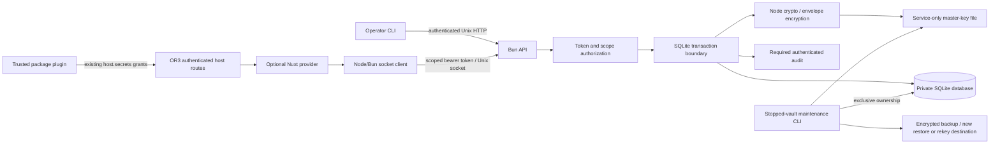

# Design

## Overview

Use one Bun process, one encrypted-value SQLite database, one Unix socket, and a small CLI. Keep application authorization in OR3 and storage authorization in the service. The master key never enters OR3. The optional provider uses a protected service-token file and a Node-compatible socket client.

This is a new implementation using standard cryptography, not a port or fork. Adopt explicit secret disclosure from secretctl and scope-bound envelope encryption/key separation from Dopbase. Their additional UI, execution, caching, and identity features are outside this product. [Source analysis](source-analysis.md) records the evidence and limitations.

Security takes precedence over availability: missing keys, invalid authority, audit failures, and an unavailable configured provider produce errors. No automatic credential migration or offline cache is included.

## Architecture



| Component | Responsibility | Requirements |
| --- | --- | --- |
| Lifecycle/files | Explicit init, safe paths, exclusive ownership, startup verification | R1, R8 |
| Crypto | Envelope encryption, authenticated state, domain-separated keys | R2 |
| Authority | Token digest/policy verification, expiry, capabilities, exact scope matching | R3 |
| API | Unix transport, strict bounded protocol, sanitized failures | R4 |
| Store | Prepared SQL, revisions/tombstones, transactions | R5 |
| Audit | Transactional events, MAC chain, receipts and verification | R6 |
| CLI/maintenance | Explicit input/output, backup/restore/rekey | R7, R8 |
| SDK/Nuxt/host adapter | Node-safe provider and first consumer with existing OR3 authority | R9, R10 |
| Qualification | Failure-first E2E checks and redacted evidence | R11 |

**Trust boundaries.** Filesystem access protects the key and service token; API bearer credentials protect socket operations; authenticated scope protects tenants; AEAD protects persisted values; OR3's session and activation authority protects browser requests. Each is necessary. Socket access alone is insufficient, and a valid service token does not prove an end user's identity.

**Threats addressed.** Copied databases/backups; accidental secret output; a client trying another workspace/owner/plugin; malformed requests; stale references/concurrent writes; modified ciphertext or policy; unsafe startup paths; failed audit writes; interrupted maintenance. A database writer may destroy or replay previously valid storage. AEAD/MACs detect altered authenticated material but cannot provide availability or external freshness. Root, same-service-UID compromise, memory inspection, and authorized consumer exfiltration remain outside the boundary.

## Components and Interfaces

### Proposed repository layout

```text
src/
  cli.ts                    # parseArgs; no CLI framework
  server.ts                 # Bun.serve Unix listener
  protocol.ts               # small shared wire types and validation
  files.ts                  # private files and ownership lifecycle
  crypto.ts                 # node:crypto only
  store.ts                  # bun:sqlite, authorization + data + audit transactions
  maintenance.ts            # stopped-vault backup/restore/rekey
  client.ts                 # node:http socketPath; no bun:* imports
  module.ts                 # optional @nuxt/kit module
  runtime/plugin.ts         # Nitro registration adapter
tests/                      # process/API/CLI/provider E2E; crypto vectors only as justified
docs/                       # security model and operator runbook
planning/secure-secret-store/
```

Start with these direct modules; split only when the implementation proves a need. No backend framework, ORM, JWT library, global plugin engine, separate daemon language, or extra database. `@nuxt/kit` is the provider module's optional peer/build dependency. Bun and TypeScript types are development dependencies. No external runtime dependency is expected for the core.

### Service contract

```ts
type Scope = Readonly<{
  namespace: string;    // operator-configured deployment boundary
  ownerUserId: string;  // OR3's internal user ID
  workspaceId: string;
  consumerId: string;   // trusted plugin ID for the first integration
}>;
type SecretRef = Readonly<{ id: string; revision: number }>;
type SecretMeta = Readonly<{
  ref: SecretRef;
  name: string;
  state: 'available' | 'deleted';
  updatedAt: string;
}>;
interface SecretStore {
  inspect(input: { scope: Scope; name: string }): Promise<SecretMeta | null>;
  list(input: { scope: Scope; after?: string; limit?: number }):
    Promise<{ items: SecretMeta[]; next?: string }>;
  put(input: { scope: Scope; name: string; value: string;
    expectedRevision: number }): Promise<SecretMeta>;
  resolve(input: { scope: Scope; selector: { name: string } | { ref: SecretRef } }):
    Promise<{ value: string; meta: SecretMeta }>;
  delete(input: { scope: Scope; name: string; expectedRevision: number }):
    Promise<SecretMeta>;
}
```

`expectedRevision: 0` means no record has ever existed. A tombstone keeps its ID and last revision; recreation must name that revision and advances it. A reference requires the exact current live revision. A name-based resolve atomically reads the latest live revision. Names never become filesystem paths. A reference from another scope is indistinguishable from a missing record.

Authenticated `POST /v1/secrets/{inspect,list,put,resolve,delete}` carries the complete request in JSON, keeping names and scope out of URLs. Each maps to one contract method. Capability names are `metadata`, `read`, `write`, and `delete`, explicitly enumerated on a token. A `read` token does not implicitly get enumeration or mutation. The provider gets the capabilities its host adapter needs; tests use narrower tokens to verify separation.

`POST /v1/tokens/{issue,list,revoke}` accepts only the operator credential. Issuance returns a credential once over the protected socket to the CLI, which writes it directly to an exclusive private file. Service tokens require a namespace, optional exact restrictions on other scope fields, explicit capabilities, and explicit expiry; recommend 30 days and enforce a maximum of 90 days. Omitted or unlimited expiry is rejected. There are no globs, delegation, or arbitrary policy expressions. The operator credential is a nonexpiring offline-custody credential kept in its own private file and cannot use the secret routes. Recovery of operator authority is offline and follows the rekey workflow.

All requests require bearer authentication. There is no unauthenticated diagnostic endpoint exposing vault identity. A token-authenticated status call may return protocol/schema version and expected-vault match, never secrets. No cookies, CORS, redirects, browser `Origin`, or HTTP proxy support. The client does not follow redirects and cannot switch to TCP.

Initial fixed limits: 256 KiB encoded request, 32 KiB decoded UTF-8 value, 128 UTF-8 bytes per nonempty name/scope field, 100 metadata results per page, 16 in-flight requests, 5 seconds to receive the body, and 1 second SQLite busy wait. Reject control characters and invalid Unicode rather than normalizing identifiers into aliases. Plugin IDs also retain OR3's existing validation. Cursor scope is reauthorized on every page; a cursor conveys no authority. Measure limits in qualification before changing them.

### Cryptography and filesystem lifecycle

- `init` generates a 32-byte binary master key and independent random vault/record/token IDs with `node:crypto.randomBytes`. No `Math.random`, password hashing, or external entropy service.
- Derive keys using HKDF-SHA-256 with vault ID as salt and versioned purpose labels: `wrap`, `record-mac`, `audit`, `verify`, and `backup`. Purpose bytes and encodings are specified once with fixtures.
- Each secret write generates a new 32-byte data key. AES-256-GCM encrypts the UTF-8 value with a random 12-byte nonce and 16-byte tag. Another independently generated nonce wraps the data key with the wrapping key. Never reuse a data key on update.
- AAD is UTF-8 JSON of a fixed-position, versioned array: domain, format, purpose, vault ID, record ID, all four scope fields, name, revision. Use separate `value` and `wrapped-key` purposes. Do not concatenate unescaped delimiter-separated strings.
- Authenticate the complete stored row, including its state and encrypted fields, with `record-mac`; this also protects tombstones. Authenticate each complete token policy/digest/revocation record with a distinct record domain. Use constant-time comparison for fixed-size MACs and token digests. Verify before using policy or returning metadata.
- The authenticated vault header records schema, key verification data, and wrapping-operation count. Refuse new writes at one million wraps under the current wrapping key; offline rekey resets this limit with a fresh key. Random nonces avoid counter reuse after a restored backup. This bound does not prevent replay of an older valid vault, which remains an explicit limitation.
- Verify a known, vault-bound encrypted marker before listening. Missing or wrong keys are fatal. Schema version changes require explicit stopped-vault maintenance; no startup migration machinery in v1.
- Establish `umask 077` before creation; private directories are `0700`, private files `0600`. Use exclusive creation and `O_NOFOLLOW` where supported, then `fstat` owner/type/mode checks. Require private, service-owned leaf directories and reject unsafe writable ancestors; account explicitly for sticky temporary parents in disposable tests. SQLite lives only in the validated private directory, including journal files.
- Acquire SQLite exclusive ownership before opening the listener or maintenance. Never unlink a pre-existing socket implicitly. On normal shutdown remove only the socket inode created by this process; document how an operator verifies a stopped service before removing a crash-left socket.
- Default socket access is owner-only. A container deployment may explicitly use a dedicated shared group, a service-owned `0750` run directory, and `0660` socket mode. Clients can connect but cannot replace the socket or write its parent directory. OR3 receives neither database nor master-key mounts. Never make the whole vault group-readable to solve socket access.
- Do not auto-load project `.env` files in the service launcher. Qualify Bun's `--no-env-file` behavior on the pinned version. Environment configuration may contain paths, never raw key/token/secret material. Runtime flags and inherited preload/debug behavior are under the trusted operator's control.

Use established Node [crypto APIs](https://nodejs.org/api/crypto.html), particularly AEAD final-tag verification. Avoid cryptographic format options: one versioned algorithm set. Mutable buffers are cleared in `finally` where possible; this is hygiene, not a promise that plaintext never exists in memory.

### CLI and client

Commands: `init`, `serve`, `status`, `put`, `get`, `inspect`, `list`, `delete`, `token issue|list|revoke`, `audit verify`, `backup`, `restore`, and `rekey`. Security maintenance is required for a usable store, not a new general administration platform. No shell execution or plaintext bulk export commands.

CLI options carry paths, scope, names, and revisions. `put` reads exact stdin bytes, including a trailing newline if present; document a newline-free input example. `get` refuses default output and requires `--stdout` or `--out-file` with exclusive `0600` creation. Credentials never go in flags or normal stdout. Mutations print metadata only. File-output failures return nonzero and do not fall back to stdout. A lost mutation response is not retried automatically.

The exported `/client` uses [node:http `socketPath`](https://nodejs.org/api/http.html), capped response size, an overall timeout, `AbortSignal`, no redirect handling, no response cache, and sanitized errors. It loads/validates the token file on each call so atomically replacing a protected file rotates credentials without a process restart. It verifies the configured vault ID on authenticated responses. No secret or credential is embedded in a client factory's string representation or diagnostic output.

### OR3 integration

The new repository exports the CLI, `/client`, and optional `/nuxt`. OR3 receives a distinct `SecretStore` registry using `server/utils/registry/create-runtime-config-registry.ts`. Private runtime configuration is `secrets.provider: 'or3-secrets'` plus `secrets.socketPath`, `tokenFile`, `namespace`, and `vaultId`. The module only registers a Nitro provider; it does not own auth, sync, or workspace selection. Static builds do not start the service or embed credentials. Selection of an unregistered/unavailable provider fails closed; absence of a selected provider preserves current deployments.

First consumer: **remembered `host.secrets` for authenticated, package-backed trusted-host activations**. Add host-owned endpoints/adapter using the existing session and sealed activation mechanism in `server/utils/plugins/isolation/activation-authorization.ts`; reuse package selection, `authorizeHostActivation`, current grant review, and mutation intent/body limits. General `requirePluginAccess` alone is insufficient because it is not a `secrets.*` grant check. Never trust browser-provided grants, user ID, workspace ID, or package digest as authority.

The adapter captures activation/account/workspace generation, checks authority before dispatch, and checks liveness before publishing results. Keep requests bound to their original scope throughout. Authorization admits an operation at dispatch; an operation already sent to the separate service can finish after local teardown. Do not imply that aborting HTTP rolls back a committed mutation. Existing package lifecycle leases should be reused where required to prevent package promotion/disable races; do not introduce a second activation system.

Extend the internal browser `SecretStore` seam to allow awaited operations and catch provider errors in `trusted-mediation.ts`. The public `PluginSecretsClient` is already asynchronous. Preserve `secrets.read` for plaintext get/status, `secrets.write` for set/delete, and `secrets.use` for refs. The default omitted persistence option continues remembered behavior for compatibility; explicit `session` lives only in activation memory and shadows a remembered value for that activation. A delete first deletes remembered state successfully, then clears the session shadow; failure leaves a visible error. `ref` never resolves plaintext. The server service has no unlock/password state; `unlock` checks availability and returns a structured failure when unavailable.

The public setter lacks an expected revision: its adapter inspects then makes one CAS write; a concurrent writer returns a conflict rather than being overwritten or retried silently. Expose the real service revision in persistent references. Account/workspace changes discard in-flight results and session shadows. Unsupported legacy/local-only activations return unavailable when this provider is selected. Existing localStorage/Dexie values are not uploaded or deleted; the operator documents re-entry of remembered secrets.

Future consumers have separate work: moving connection credentials requires a reference schema, durable-store changes, and a cross-store consistency/migration design. Webhooks, Connect, background-job recovery, and the browser OpenRouter flow have different lifetimes/authority. A registry entry alone does not migrate or secure them.

## Data Models

| SQLite table | Stored fields and invariants |
| --- | --- |
| `vault` | Singleton format/schema, random vault ID, verification ciphertext, wrap count, authenticated header. No master key. |
| `secrets` | Random ID; exact scope + name unique tuple; monotonic integer revision; live/tombstone state; timestamps; value ciphertext/nonce/tag; wrapped data key/nonce/tag; row MAC. Tombstones discard encrypted value/key fields. |
| `tokens` | Public ID; SHA-256 digest of random bearer credential; operator/service kind; exact policy fields; expiry/revocation; row MAC. No raw credentials. |
| `audit` | Monotonic sequence, previous MAC, canonical event payload, HMAC-SHA-256. No secret names/values or arbitrary free text; scope identity is a keyed digest. |

Use strict prepared bindings and database constraints for uniqueness, integer ranges, and tombstone/live field consistency. `bun:sqlite` strict parameter mode, `foreign_keys=ON`, `trusted_schema=OFF`, rollback journal, `synchronous=FULL`, and exclusive single-process ownership. A low-volume store does not need WAL or multiple writers. Startup checks the schema, verification marker, authenticated header, all record/token MACs, and complete audit chain. Record/token MACs are also checked before use; maintenance verifies all rows. Do not claim that row MACs detect removal of an entire valid row without reconstructing an externally anchored inventory.

All authenticated secret operations enter a synchronous SQLite transaction: authenticate token state/policy, validate scope, read current revision, verify row, perform action, append audit, commit. No `await` inside the transaction. No plaintext is released until audit commit succeeds. Invalid authentication is handled without unbounded audit growth; emit only bounded aggregate rejection diagnostics. Authenticated denials receive a sanitized audit event when storage is healthy, without disclosing target existence.

### Backup, restore, and rotation

Only stopped-vault maintenance may take ownership. `backup` verifies the source and makes a consistent ciphertext SQLite snapshot. Encrypt the whole snapshot with streaming AES-256-GCM under a backup key derived from the master key, vault ID, and fresh backup salt. Use one fixed binary payload format: bounded versioned header (including vault ID, salt, nonce), ciphertext, and final tag. Authenticate the header as AAD; no archive entries or attacker-controlled extraction paths. Backups hide metadata as well as values and contain no master key or raw token file. Never load an entire backup into memory.

`restore` authenticates streaming decryption into a new private temporary destination and opens no SQLite file until tag verification completes. Verify `quick_check`, schema, key marker, all row MACs, and audit chain before marking the destination complete. Compare a separately stored audit receipt when one is supplied. Restored tokens start revoked; create fresh operator authority offline, then issue fresh service tokens. Restore preserves old secret values/revisions, so operators must reconcile credentials rotated since the snapshot. Missing recovery key means the backup is unrecoverable.

`rekey` also uses a new destination, preserving vault ID, record IDs, and revisions. Verify old state, decrypt/re-encrypt every live value with fresh data keys under the new wrapping key, re-authenticate metadata, revoke old tokens, and create fresh operator authority. Verify the old audit history, rebuild its MAC chain under the new audit key, and append a rotation event linking the old head to the new receipt. Record both receipts; their MACs deliberately change. Verification markers/header/count are rebuilt. Preserve source and old recovery material until the operator validates a restore and explicitly accepts cutover. This rotates future custody; it cannot revoke plaintext or old backups already stolen.

Maintenance uses exclusive output creation and completion markers. Incomplete destinations stay private and are refused as vaults; deleting them requires an explicit operator action. No command overwrites a running source or automatically points OR3 at a new destination.

## Error Handling

| Condition | API / CLI behavior |
| --- | --- |
| Invalid/expired/revoked token or unauthenticated status | `401 unauthorized`; generic detail |
| Valid token without operation/scope authority | `403 forbidden`; no target existence signal |
| Authorized missing/deleted/mismatched ref | `404 not_found` |
| Stale expected revision | `409 revision_conflict`; metadata must be reloaded |
| Schema/type/content violation | `400 invalid_request` or `415 unsupported_media_type` |
| Body/value limit | `413 too_large`; abort bounded read |
| Concurrency ceiling | `429 busy`; no automatic mutation retry |
| Storage/audit unavailable | `503 unavailable`; no secret value or mutation success |
| MAC/tag/key/schema corruption | Stop serving affected operations and terminate into an operator-required failed state; sanitized `503` if a response is possible |
| Wrong vault ID in SDK | Reject response and mark provider unavailable |
| CLI usage/auth/conflict/unavailable/verification failure | Stable documented exit categories; sanitized stderr; no fallback output |

Do not echo SQL, paths, value fragments, bearer headers, parser excerpts, upstream response bodies, or crypto exception messages. Crypto/storage failures are operationally distinguishable using fixed event codes and request IDs, never customer input. Avoid claiming all denial logging is durable under an attacker-driven flood or a failed disk.

## Testing Strategy

Before production code for each boundary, record its failure cases and create checks that fail against the missing/broken implementation. Primary coverage launches the real CLI/service with temporary Unix sockets and databases. No test-only production flags, fake cryptography, or assertions that merely mirror internal helpers. A small independent-vector crypto suite is justified for byte encodings and tag/AAD correctness that black-box lifecycle tests alone cannot establish.

| Failure class | Observable check / negative control |
| --- | --- |
| Scope and capabilities | Two users/workspaces/plugins/namespaces; try every operation across each boundary, guessed IDs, replayed refs, metadata-only/write-only tokens; tamper a policy field and prove denial. |
| Crypto/storage | Known independent AES-GCM/HKDF vectors; mutate ciphertext, tag, wrapped key, every AAD field, row state/MAC, and vault marker; no plaintext and no silent repair. |
| Files/startup | Missing/wrong key, exposed modes, symlink/nonregular paths, existing outputs/socket, second owner; demonstrate no overwrite and no listener on failure. |
| Consistency | Concurrent CAS has exactly one winner; delete/recreate never revives a ref; expired/revoked tokens fail after commit; lost-response metadata reconciles an unknown write. |
| Audit/durability | Force real write failure in a disposable Linux filesystem; read releases no plaintext, write does not commit without event; alter/reorder audit events; show a saved receipt detects a shortened history while an unanchored old snapshot is not falsely classified as fresh. |
| Crash/recovery | Terminate processes at observable write/maintenance boundaries; restart sees prior or complete committed state; source remains intact after aborted backup/rekey. |
| CLI/disclosure | Canary values survive exact stdin roundtrip; default get refuses; argv/logs/DB/journal/backups/error artifacts lack raw canaries and tokens; explicit stdout is the sole intentional stdout disclosure path. |
| Backup/rekey | Wrong key, modified/truncated/oversized header, failed destination creation; complete authentication before SQLite use; restore to new path; old tokens rejected and fresh tokens work; no source mutation. |
| OR3 provider | Real authenticated package activation with approved grants; another account/workspace/plugin, grant revocation, disable/update, stale async completion, session persistence, conflict, unavailable service, wrong vault, and forbidden browser bundle imports. |
| Runtime/package | Pinned Bun on macOS/Linux; Node 24 client; module import/static build; clean package qualification with no sibling aliases or developer `.env`. |

Use synthetic data only. Tests emit `test-results/security-receipt.json` with commit/runtime/platform, named outcomes, permission checks, observed listeners, backup/recovery fixture checksums, and resource measurements; never secret values or real credential hashes. Include deliberate broken fixtures to prove detection. No performance claim until a small Linux run records idle RSS, startup time, and latency for 1,000 synthetic secrets at 10 operations/second; this is characterization, not a reason to introduce caching or concurrency infrastructure.

## Design Decisions

| Decision | Reason / rejected expansion |
| --- | --- |
| Unix socket only | Makes same-host deployment useful while removing a remote TLS/login surface. Remote support requires a separate security design. |
| Bun SQLite + Node crypto | Existing supported primitives, no custom cipher, no ORM/server framework. Verify exact-version behavior rather than relying on current docs alone. |
| Per-write envelope encryption | Scope/revision authentication and clear master-key separation; small fixed format rather than configurable algorithms. |
| Random master key, file bootstrap | Avoids a password/unlock/session subsystem. A mounted key is bootstrap custody, not elimination of the bootstrap problem. |
| Database-level atomic audit | A second JSONL log would make fail-closed atomic mutation harder. A MAC chain plus separately held receipts has honest, limited guarantees. |
| No cached plaintext or availability fallback | Prevents revoked credentials or outages from silently falling back to stale local values. |
| Offline maintenance to a new destination | Avoids online key-rotation races and destructive restore; source remains recoverable. |
| Trusted-plugin remembered secrets first | Concrete current plaintext persistence gap; no connection cross-store migration in the initial release. Raw read remains governed by the existing trusted-plugin grant. |
| No automatic import | Existing values may have different owners/scopes; explicit re-entry avoids silently assigning incorrect authority. |

Implementation references: [Bun SQLite](https://bun.sh/docs/runtime/sqlite), [Bun HTTP server](https://bun.sh/docs/runtime/http/server), [Bun environment loading](https://bun.sh/docs/runtime/environment-variables), [OWASP secrets management](https://cheatsheetseries.owasp.org/cheatsheets/Secrets_Management_Cheat_Sheet.html). These support API/security choices, not a claim that this implementation has already been qualified.

## Risks & Mitigations

1. **Bun/runtime behavior and JavaScript plaintext lifetime.** Pin and qualify actual Bun/Node versions, isolate key custody, avoid unnecessary strings/copies, and state memory limits. Independent review is still needed before high-value production use.
2. **OR3 authority drift across asynchronous boundaries.** Reuse live sealed activation/grant checks, preserve captured scope, reject stale completions, test lifecycle races, and state that an already admitted remote mutation can finish.
3. **Bootstrap key or OR3 service-token compromise.** Separate mounts/users, exact namespaces/capabilities, short-lived service tokens, replacement/revocation procedures, encrypted backups, and tested offline rekey. A compromised authorized server remains powerful within its scope.
4. **Audit/storage rollback and resource exhaustion.** Fail closed on required writes; cap requests; monitor disk and audit growth; retain external receipts. Valid older state cannot be rejected as old without a trusted external observation. No automatic log pruning in v1.
5. **Maintenance complexity undermining the minimal core.** Keep one fixed backup format and stopped-vault workflows, implement failure checks before code, and refuse overwrites. Do not ship real credentials until recovery works; defer all optional platform features.
